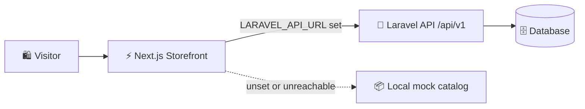

<div align="center">


**A full-stack jewellery storefront for handcrafted Bangladeshi jewellery.**
*Responsive catalog · Laravel API · graceful mock-data fallback*

<br />


<br />

[✨ Features](#-features) &nbsp;•&nbsp;
[🧰 Tech Stack](#-tech-stack) &nbsp;•&nbsp;
[🗂 Structure](#-project-structure) &nbsp;•&nbsp;
[🚀 Quick Start](#-quick-start) &nbsp;•&nbsp;
[🔌 API](#-api-reference) &nbsp;•&nbsp;
[☁️ Deploy](#️-deployment) &nbsp;•&nbsp;
[🗺 Roadmap](#-roadmap)

</div>

<!--
📸 Add a homepage screenshot, then uncomment the block below:

<div align="center">
  
</div>
-->

---

## 🌸 About

**Goynar Gontobbo** is a full-stack jewellery storefront for showcasing handcrafted Bangladeshi jewellery. It pairs a responsive, customer-facing catalog with a Laravel backend foundation for managing **products, categories, materials, purities, images, and variants**.

> [!NOTE]
> **Project status:** The storefront reads the Laravel catalog API when configured and falls back to local mock catalog data when the API is unavailable. Email/password customer registration and login use the Laravel database when configured. Checkout, persisted customer preferences, and server-side administration are **not implemented yet**. Local role previews are for demonstration only.

### 🧭 How it fits together



---

## ✨ Features

<table>
  <tr>
    <td width="50%" valign="top">
      <h4>📱 Responsive storefront</h4>
      Polished design with desktop and mobile navigation.
    </td>
    <td width="50%" valign="top">
      <h4>🏠 Rich homepage</h4>
      Hero, categories, new arrivals, best sellers, brand story, and customer assurances.
    </td>
  </tr>
  <tr>
    <td valign="top">
      <h4>💍 Jewellery categories</h4>
      <b>Earrings, rings, bangles, necklaces, jhumka, cuffs, tana,</b> and <b>sets</b>.
    </td>
    <td valign="top">
      <h4>৳ Taka pricing</h4>
      Bangladeshi Taka (<code>৳</code>) pricing in the current catalog mock data.
    </td>
  </tr>
  <tr>
    <td valign="top">
      <h4>🗄 Product-oriented schema</h4>
      Categories, materials, purities, products, product images, and variants.
    </td>
    <td valign="top">
      <h4>🔐 Laravel-ready foundations</h4>
      Support for users, database-backed sessions, cache, and queues.
    </td>
  </tr>
  <tr>
    <td valign="top">
      <h4>🔁 Graceful fallback</h4>
      Automatically switches to mock data when the API is unavailable.
    </td>
    <td valign="top">
      <h4>🔎 SEO-friendly</h4>
      Page metadata, canonical URLs, robots rules, and an XML sitemap.
    </td>
  </tr>
</table>

---

## 🧰 Tech Stack

| Area | Technology |
| :-- | :-- |
| 🎨 **Frontend** | Next.js 16 · React 19 · TypeScript |
| 💅 **Styling** | Tailwind CSS 4 · PostCSS |
| ⚙️ **Backend** | Laravel 12 · PHP 8.2+ |
| 🗄 **Data** | SQLite by default; MySQL, MariaDB, PostgreSQL, and SQL Server configurable |
| 🔧 **Tooling** | ESLint · PHPUnit · Vite |

---

## 🗂 Project Structure

```text
goynar-gontobbo/
├── 🎨 frontend/                  # Next.js customer storefront
│   ├── app/                      # App Router pages and global styles
│   ├── components/               # Reusable UI sections and product cards
│   ├── data/                     # Temporary mock categories and products
│   ├── public/                   # Static assets
│   └── types/                    # TypeScript domain types
├── ⚙️ backend/                   # Laravel application
│   ├── app/                      # Application code
│   ├── config/                   # Laravel configuration
│   ├── database/migrations/      # Catalog and framework migrations
│   ├── database/seeders/         # Idempotent sample catalog data
│   ├── routes/                   # Server routes
│   └── tests/                    # PHPUnit tests
└── 📖 README.md                  # This project guide
```

---

## 🚀 Quick Start

### 📋 Prerequisites

| Tool | Version |
| :-- | :-- |
| 🟢 **Node.js** + npm | 20.9+ |
| 🐘 **PHP** | 8.2+ |
| 🎼 **Composer** | 2 |
| 🪶 **SQLite** | Recommended for local dev (or any supported database server) |

### 1️⃣ Backend

From the repository root:

```bash
cd backend
composer install
cp .env.example .env
php artisan key:generate
```

Configure the database (see [Database Setup](#-database-setup)), then migrate and seed:

```bash
php artisan migrate --seed
php artisan serve
```

> 🌐 The backend runs at `http://127.0.0.1:8000` by default.

### 2️⃣ Frontend

In a **separate terminal**:

```bash
cd frontend
npm install
npm run dev
```

> 🌐 Open [http://localhost:3000](http://localhost:3000) in your browser.

### 3️⃣ Run both together

```bash
# Terminal 1 — backend
cd backend
php artisan serve
```

```bash
# Terminal 2 — frontend
cd frontend
npm run dev
```

### 🧪 Handy commands

| Command | Where | What it does |
| :-- | :-: | :-- |
| `npm run lint` | `frontend/` | Lint the frontend |
| `npm run build` | `frontend/` | Production build |
| `npm run start` | `frontend/` | Serve the production build |
| `php artisan test` | `backend/` | Run PHPUnit tests |

---

## ⚙️ Environment & Configuration

Copy `backend/.env.example` to `backend/.env`.

> [!WARNING]
> **Never commit** the resulting `.env` file or any credentials.

<details>
<summary><b>📑 Backend environment variables</b> (click to expand)</summary>

<br />

| Variable | Purpose | Local example |
| :-- | :-- | :-- |
| `APP_NAME` | Laravel application name | `Goynar Gontobbo` |
| `APP_ENV` | Runtime environment | `local` |
| `APP_KEY` | Laravel encryption key | Generated with `php artisan key:generate` |
| `APP_URL` | Public backend URL | `http://127.0.0.1:8000` |
| `DB_CONNECTION` | Database driver | `sqlite` or `mysql` |
| `DB_DATABASE` | SQLite file path or database name | `database.sqlite` or `goynar_gontobbo` |
| `DB_HOST`, `DB_PORT` | Database host and port | `127.0.0.1`, `3306` for MySQL |
| `DB_USERNAME`, `DB_PASSWORD` | Database credentials | Your local database credentials |
| `SESSION_DRIVER`, `CACHE_STORE`, `QUEUE_CONNECTION` | Laravel service drivers | `database`, `database`, `database` |

</details>

### 🔗 Connecting the storefront to Laravel

Set the following in `frontend/.env.local`:

```dotenv
LARAVEL_API_URL=http://127.0.0.1:8000
```

The server-rendered catalog will then read from Laravel. If the variable is unset or the API is unreachable, the storefront falls back to its local mock catalog. This variable **stays on the server** and is not exposed to visitors' browsers.

### 🔑 Google sign-in & profile autofill

Google profile autofill and sign-in require a **Google Identity Services OAuth web client ID**.

1. Create a Google Identity Services OAuth **Web application** client ID and add the exact storefront origin to its authorized JavaScript origins (`http://localhost:3000` locally and your Vercel domain in production).
2. Set that same client ID as `NEXT_PUBLIC_GOOGLE_CLIENT_ID` and `GOOGLE_CLIENT_ID` in the frontend environment (see `frontend/.env.example`). The server verifies the token signature, issuer, audience, expiry, and verified email. Login requests must be same-origin and create a short-lived HTTP-only cookie.

**How it works:**

- The browser displays Google's official account button; the server verifies its signed ID token with Google's public signing keys.
- **Registration** uses the verified name and email to fill the form.
- **Login** establishes a short-lived, HTTP-only browser session that lasts no longer than the Google ID token (up to one hour). Signing out clears that session.
- Email/password registration and login create and authenticate customer records in the configured Laravel database. Customer preferences and orders are not persisted by the backend yet.

---

## 🛡 Encryption & Browser Data

- 🔒 Laravel uses **AES-256-CBC** through its framework encrypter. Keep `APP_KEY` secret, generate it with `php artisan key:generate`, and set it as a secret environment variable on the server. The Render Blueprint generates `APP_KEY` for the service.
- 🗝 `SESSION_ENCRYPT=true` enables Laravel's built-in encryption for server-side session data.
- 🛑 Never rotate `APP_KEY` casually: encrypted cookies and stored values may become unreadable unless the old key is retained in `APP_PREVIOUS_KEYS` where supported.

> [!IMPORTANT]
> The **cart and wishlist** are convenience data stored in browser `localStorage`. They are **not** a secure store for passwords, payment details, or other secrets. Encrypting data in JavaScript with a key bundled to the same browser would not protect it from the browser's owner or malicious scripts. Account passwords are hashed by Laravel; authenticated API tokens are stored in the browser for this preview. Deploy account services only over HTTPS and keep production secrets private.

---

## 🗄 Database Setup

### 🪶 SQLite (default)

Laravel defaults to SQLite. Create the local database file, then migrate:

```bash
cd backend
touch database/database.sqlite
php artisan migrate --seed
```

Keep `DB_CONNECTION=sqlite` in `backend/.env`. Laravel uses `database/database.sqlite` unless `DB_DATABASE` specifies another path.

### 🐬 MySQL / MariaDB

Create a database, then set the following in `backend/.env`:

```dotenv
DB_CONNECTION=mysql
DB_HOST=127.0.0.1
DB_PORT=3306
DB_DATABASE=goynar_gontobbo
DB_USERNAME=your_database_user
DB_PASSWORD=your_database_password
```

Run `php artisan migrate --seed` after saving to create the catalog tables and load sample catalog data.

---

## 🔌 API Reference

The Laravel backend exposes a **public, read-only** catalog API under `/api/v1`:

| Method | Endpoint | Purpose |
| :-: | :-- | :-- |
|  | `/api/v1/categories` | List active categories with active product counts |
|  | `/api/v1/products` | Paginated active products; accepts `q`, `category`, and `per_page` filters |
|  | `/api/v1/products/{slug}` | Fetch one active product by slug |

Product responses include **category, material, purity, images,** and **active variants**.

```bash
# Example
curl "http://127.0.0.1:8000/api/v1/products?category=rings&per_page=12"
```

> Set `LARAVEL_API_URL` to have the storefront read from the API; local mock data is used when the variable is unset or the API is unreachable. Customer accounts, checkout, and administration are not implemented yet.

---

## ☁️ Deployment

The repository is prepared for **Vercel** (frontend) and **Render** (Laravel API + PostgreSQL).

| Step | Where | What to do |
| :-: | :-- | :-- |
| **1** | 🟩 **Render** | Connect this Git repository and create a Blueprint from `render.yaml`. It builds `backend/Dockerfile` and runs migrations and the idempotent sample catalog seeder whenever the free web service starts. |
| **2** | ▲ **Vercel** | Connect the same repository and set the project root directory to `frontend`. |
| **3** | 🔗 **Link them** | After Render provides the API URL, set `LARAVEL_API_URL` in Vercel's project environment variables to that URL and redeploy. The storefront falls back to mock data if the API is unavailable. |

> [!CAUTION]
> This setup is for a **free demo only**.
>
> - Render's free web service sleeps after 15 minutes without traffic, so the first request after sleeping can take about a minute.
> - Its free PostgreSQL database expires after 30 days and has **no backups**; do not store important data there. The sample catalog is reseeded when the API starts.
> - Vercel Hobby is limited to noncommercial personal use.
>
> Neither service is suitable for a dependable commercial launch on these free plans.

---

## 🗺 Roadmap

- [ ] 🔐 Authenticated customer and administration API endpoints
- [ ] 🧑‍💼 Admin workflow for catalog, image, material, purity, and inventory management
- [ ] 🛒 Complete checkout, order management, and customer account experiences
- [ ] 💳 Payment gateway, delivery tracking, and customer notifications
- [ ] ✅ Test coverage for catalog workflows and CI/CD
- [ ] 🚀 Optimized product images, accessibility, observability, and production security controls

---

## 📄 License

Copyright © 2026 Aftab Uddin Ahmad. All Rights Reserved.

This project is proprietary software. The source code is publicly available for viewing, learning, evaluation, and portfolio purposes only.

Commercial use, redistribution, or substantial reuse requires prior written permission from the copyright holder.

See the [LICENSE](LICENSE) file for the complete terms.

<div align="center">

<br />

💍 **Goynar Gontobbo** 💍

*Crafted with ♥ in Bangladesh*


</div>
